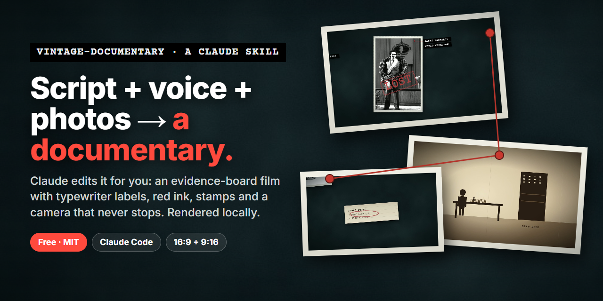
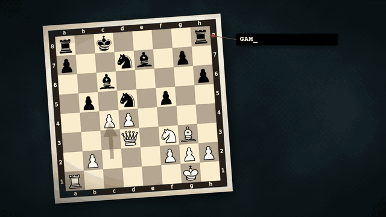
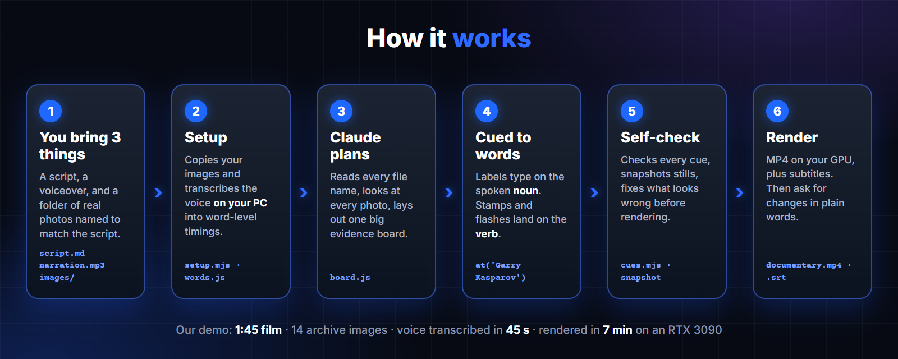
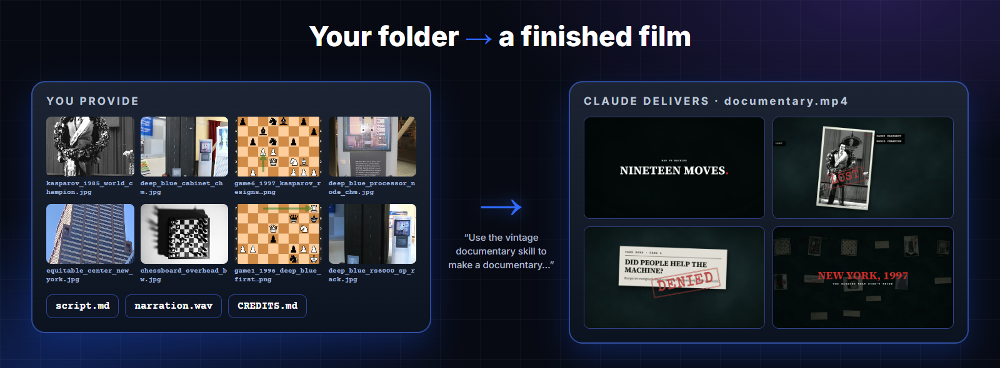
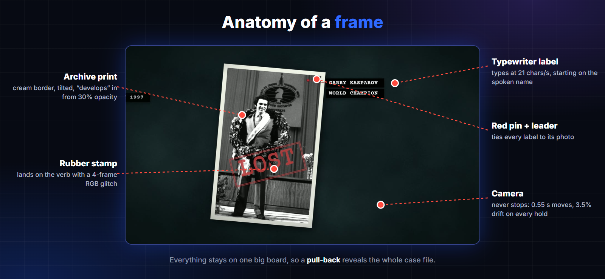
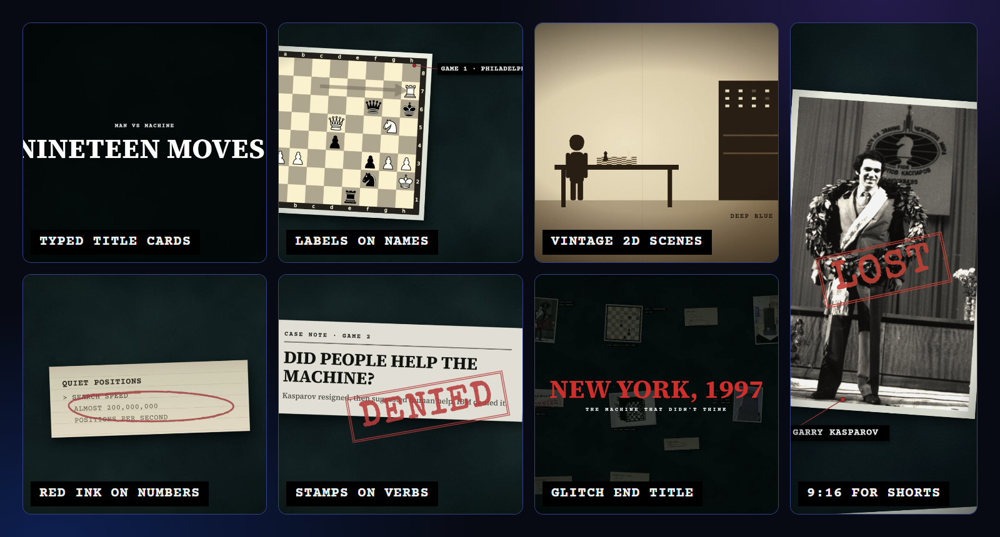

<p align="center">
  
</p>

<p align="center">
  <a href="#-install"></a>
  <a href="LICENSE"></a>
  
  
  
</p>

<p align="center">
  <b>You bring a script, a voiceover and real photos. Claude edits the documentary.</b><br>
  No editing app, no timeline, no paid plugins. Everything renders on your own computer.
</p>

<p align="center">
  <a href="#-install">Install</a> ·
  <a href="#-how-it-works">How it works</a> ·
  <a href="#-use-it">Use it</a> ·
  <a href="#-whats-in-a-frame">Anatomy</a> ·
  <a href="#-engine-cheat-sheet">Engine</a> ·
  <a href="#-faq">FAQ</a>
</p>

---

## ▶ See it

<p align="center"></p>

That clip is from **"Deep Blue: The Machine That Didn't Think"**, a 1:45 documentary made with this skill from one prompt: 14 public-domain and Creative Commons photos, a 237-word script and a free local voice. Its full board is in [`examples/deep-blue/board.js`](skills/vintage-documentary/examples/deep-blue/board.js).

---

## ⚡ Install

Pick one. All three give Claude the same skill.

**A. Claude Code plugin (recommended).** Run these inside Claude Code:

```text
/plugin marketplace add kairo-labs-ai/vintage-documentary
/plugin install vintage-documentary@kairo-labs
```

**B. One command with the open `skills` CLI** (Node 22.20+):

```bash
npx skills add kairo-labs-ai/vintage-documentary -g -a claude-code
```

**C. Copy the folder.** Put [`skills/vintage-documentary`](skills/vintage-documentary) into `~/.claude/skills/`, or download [`vintage-documentary.zip`](vintage-documentary.zip) and ask Claude: *"Install the skill in vintage-documentary.zip so you can use it."*

**You also need:** [Claude Code](https://code.claude.com) (the Code tab in the Claude desktop app, or the CLI), **Node.js 18+** and **ffmpeg** on your PATH. HyperFrames downloads its own Chrome. An NVIDIA or AMD GPU makes rendering faster but isn't required.

---

## 🧭 How it works

<p align="center"></p>

1. **Setup** copies your images and transcribes your voiceover **locally** into word-level timings. Nothing is uploaded anywhere.
2. **Claude reads** every file name and looks at every photo, then plans one big evidence board in story order.
3. **Everything is cued to words, not seconds.** A label starts typing when the narrator says the name, and a stamp lands on the verb. If you re-record the voice, everything moves with it.
4. **Claude checks its own work.** It runs a cue checker, takes still frames, looks at them and fixes what's wrong. In our demo it caught that a title said *"Checkmate"* when Kasparov actually resigned.
5. **Render** produces an MP4 on your GPU, plus optional subtitles.

---

## 🎬 Use it

<p align="center"></p>

Put three things in one folder:

```text
my-documentary/
├── script.md          ← the narration, exactly as spoken
├── narration.mp3      ← your voiceover (ElevenLabs, a local voice, your own mic…)
└── images/            ← real photos you're allowed to use, NAMED to match the script
    ├── kasparov_1985_world_champion.jpg      ✓ tells Claude where it belongs
    └── IMG_4821.jpg                          ✗ tells Claude nothing
```

Then ask Claude:

> **Use the vintage documentary skill to make a documentary from script.md, narration.mp3 and the images folder.**

Keep directing it in plain words:

| You say | Claude does |
|---|---|
| *"Make it vertical for Shorts."* | Rebuilds the board at 1080×1920, top to bottom |
| *"Add a vintage 2D animation scene when he stands up from the board."* | Adds a sepia silent-film scene with an iris in and out |
| *"Put a DENIED stamp on the case note when IBM denies it."* | Adds a stamp cued to the word *denied* |
| *"Roll the image credits at the end."* | Adds rolling credits from your `CREDITS.md` |
| *"Give me subtitles."* | Writes `documentary.srt` from the word timings |

> [!TIP]
> **Name your images.** It takes five minutes and is the single biggest quality boost: Claude reads the names first, so `game6_1997_kasparov_resigns.png` lands on the right sentence.

---

## 🔍 What's in a frame

<p align="center"></p>

<p align="center"></p>

---

## 🧰 Engine cheat sheet

Claude writes one file, `film/board.js`. The full guide is in [`SKILL.md`](skills/vintage-documentary/SKILL.md).

| Call | What it adds |
|---|---|
| `D.photo(id, {src, x, y, w, rot, at})` | Archive print that "develops" onto the board |
| `D.label(id, {on, side, text, at})` | Black typewriter strip with red pin and leader line |
| `D.note` · `D.wire` · `D.quote` · `D.card` | Ruled note card · re-typeset report card · attributed quote · custom paper |
| `D.circle` · `D.line` · `D.arrow` · `D.strike` | Hand-drawn red marker ink |
| `D.stamp(id, {on, text, at})` | Rubber stamp with a 4-frame RGB glitch |
| `D.cam(at, target)` | Camera move to an item, a group or `'all'` (a pull-back) |
| `D.title` · `D.endTitle` · `D.flash` · `D.credits` | Typed title, red glitch end title, exposure flash, rolling credits |
| `D.film(at, dur, draw)` | Vintage 2D scene from a flat sepia kit: figures, tables, chess boards, machines, buildings, crowds |
| `D.at('phrase')` | The second a phrase is spoken: every cue uses this |

Helper scripts in `scripts/`:

- `setup.mjs`: project, images and transcription (`--portrait` for 9:16)
- `cues.mjs`: finds broken cues before rendering
- `words.mjs`: prints the timed transcript
- `srt.mjs`: writes subtitles

---

## ❓ FAQ

<details><summary><b>Does it work in Claude.ai or only in Claude Code?</b></summary>

Claude Code. Making a video means running a renderer (Node, ffmpeg, Chrome) on your computer, which only Claude Code can do.
</details>

<details><summary><b>Does it cost anything?</b></summary>

The skill and HyperFrames are free and open source. Transcription and rendering run locally. You only need your Claude plan.
</details>

<details><summary><b>Where do I get images I'm allowed to use?</b></summary>

[Wikimedia Commons](https://commons.wikimedia.org) (public domain, CC0, CC BY, CC BY-SA), the Library of Congress, and national archives. Avoid agency photos (Getty, AP, Reuters). Ask Claude to find candidates *with their licences* and write a `CREDITS.md`. `D.credits` can roll them at the end.
</details>

<details><summary><b>Can it make vertical videos?</b></summary>

Yes. Run setup with `--portrait` (or just ask) for 1080×1920. Titles scale and the board is laid out top to bottom.
</details>

<details><summary><b>How long does it take?</b></summary>

For our 1:45 demo: transcription took 45 s, Claude's planning and checking about 15 minutes, and the render 7 minutes on an RTX 3090.
</details>

<details><summary><b>Something went wrong.</b></summary>

See **Troubleshooting** at the end of [`SKILL.md`](skills/vintage-documentary/SKILL.md): missing cues, a stuck render lock, CPU-only renders and transcription setup.
</details>

---

## 📁 What's inside

```text
.claude-plugin/          marketplace.json + plugin.json (Claude Code plugin install)
skills/vintage-documentary/
├── SKILL.md             instructions Claude follows
├── scripts/             setup · cues · words · srt
├── template/            engine (doc-engine.js, doc.css), fonts, board texture, page template
└── examples/deep-blue/  a finished board.js + script + image credits
docs/images/             the pictures in this README
vintage-documentary.zip  the skill folder as a zip (manual install / Claude.ai upload)
```

## 🙏 Credits

Rendered with [HyperFrames](https://github.com/heygen-com/hyperframes) and [GSAP](https://gsap.com). Fonts: Courier Prime, Special Elite, Source Serif 4 and Inter (SIL OFL 1.1).

Demo images are from Wikimedia Commons:

- Garry Kasparov, 1985: Owen Williams / The Kasparov Agency, CC BY-SA 3.0
- Deep Blue at the Computer History Museum: Anton Chiang, Erik Pitti and Christina Xu, CC BY 2.0
- Game positions: Morn, CC0
- Chessboard: Dietmar Rabich, CC BY-SA 4.0
- Equitable Center: Kidfly182, CC BY 4.0

The full list is in [`examples/deep-blue/CREDITS.md`](skills/vintage-documentary/examples/deep-blue/CREDITS.md).

MIT © Kairo Labs. Made for the Kairo Labs AI channel.
